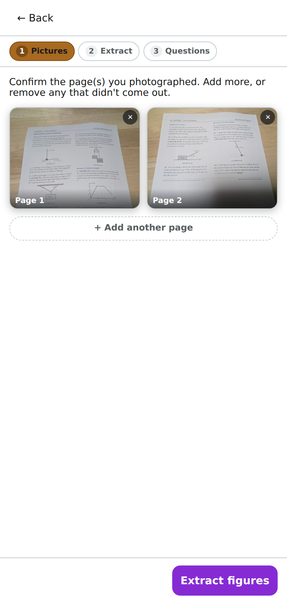
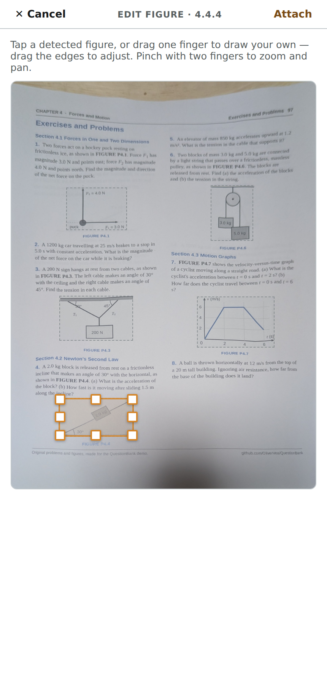
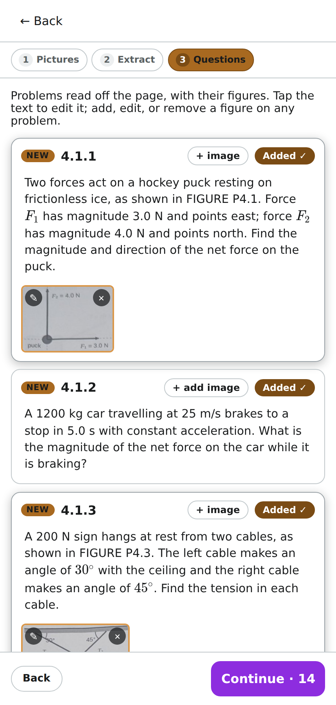
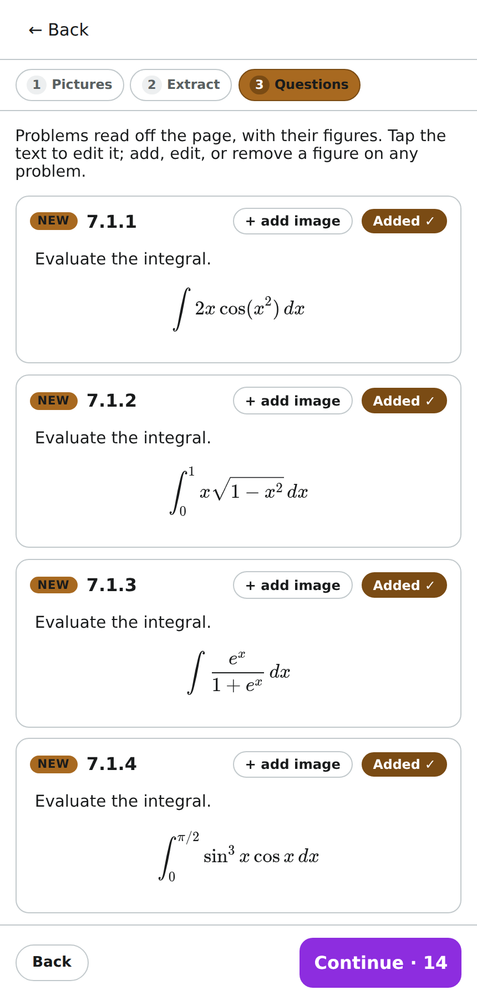
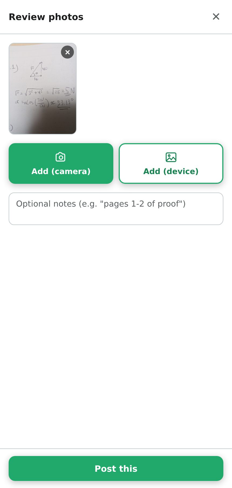
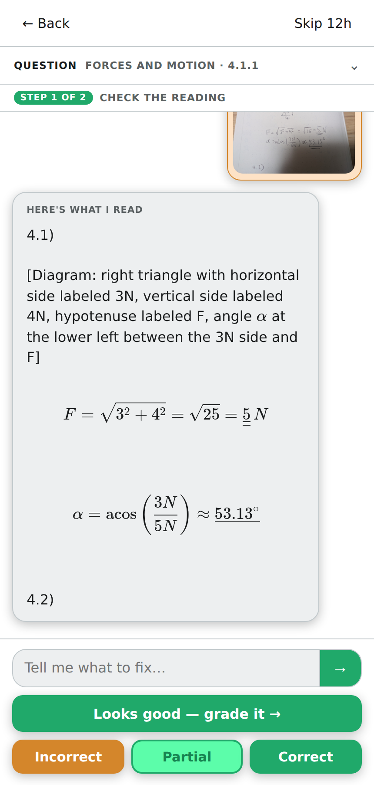
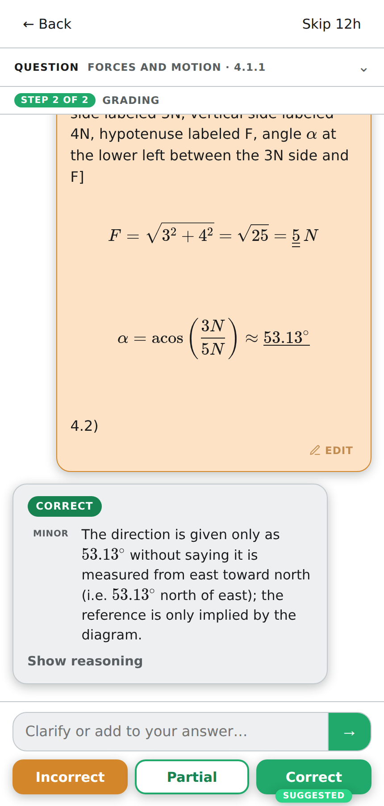
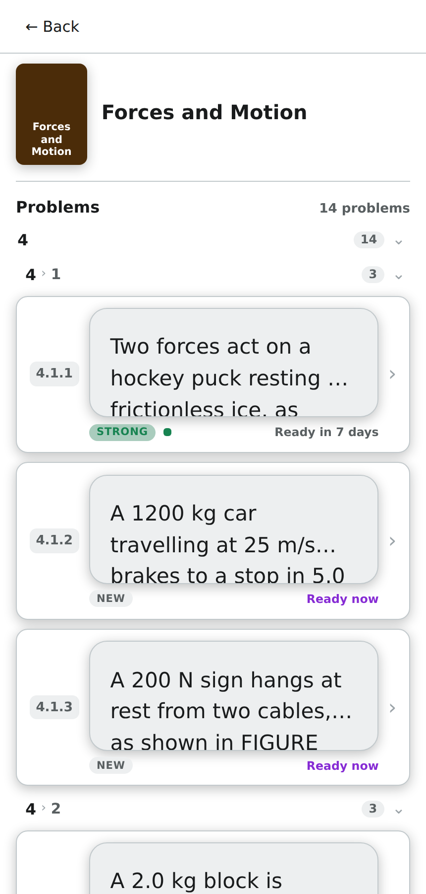
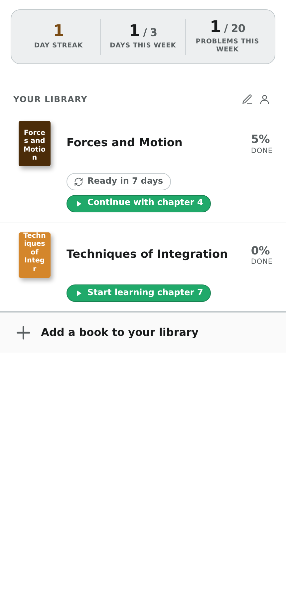

# Question Bank

A question bank for books. Client-side app backed by a small server.

## What this is

A self-study question bank for working through physics and math textbooks. It solves two problems:

**1. Grading handwritten solutions.** Capture questions from a textbook (photo or text), then submit a handwritten solution and get LLM-assisted feedback. The flow separates concerns deliberately: one agent faithfully transcribes your answer to LaTeX (told only to read it: no solving, no hints), a second agent critiques the transcribed answer and suggests a rating, and you set the final rating (DNM / partial / full).

**2. Retaining understanding.** A spaced-repetition system resurfaces questions over time (1 week, then 1 month) so the material sticks, prioritizing weaker results.

## Features

From a printed page to a scheduled review, in nine steps:

<table>
  <tr>
    <td width="33%" valign="top"><br><b>1. Photograph the pages.</b> Two pages of a problem set, shot with a phone at an angle.</td>
    <td width="33%" valign="top"><br><b>2. Figures are found.</b> Each page is flattened and its figures are outlined. You can fix a box by hand.</td>
    <td width="33%" valign="top"><br><b>3. Problems are read off.</b> Text and maths come out as LaTeX, and each figure lands on the problem that cites it.</td>
  </tr>
  <tr>
    <td width="33%" valign="top"><br><b>4. Maths-heavy pages too.</b> A page of integrals, read from a photo of the sheet held in the air.</td>
    <td width="33%" valign="top"><br><b>5. Answer on paper.</b> Solve the next problem by hand and photograph your working.</td>
    <td width="33%" valign="top"><br><b>6. Check the reading.</b> A first agent only reads your handwriting into LaTeX. It is told not to solve, correct or grade.</td>
  </tr>
  <tr>
    <td width="33%" valign="top"><br><b>7. Get it graded.</b> A second agent critiques the confirmed reading and suggests a rating. You set the final one.</td>
    <td width="33%" valign="top"><br><b>8. It comes back.</b> A full mark schedules the problem for review in a week, then a month.</td>
    <td width="33%" valign="top"><br><b>9. Keep going.</b> The library tracks progress per book, your day streak and weekly goals.</td>
  </tr>
</table>

The screenshots are one real run: the pages in [docs/demo](docs/demo/demo-pages.pdf) were printed, photographed with a phone, scanned by the app, answered by hand and graded.

**Building a book**

- **Books and problems.** A book is a flat, ordered list of problems with editable labels such as `1.A.3`.
- **Scan to add problems.** Photograph one or several pages, or paste text, and the model extracts the problems. The result is proposed as a delta against the existing list, which you can refine in a conversation before accepting or rejecting it.
- **Figure extraction.** The page photo is flattened, figures are detected, and a matcher attaches each figure to the problem that references it. A review wizard lets you add, edit or remove figure boxes. See [the design notes](docs/design/figure-extraction-hld.md).
- **Maths rendering.** Problem text is LaTeX, rendered with KaTeX and edited as raw source.

**Solving and grading**

- **Photo answers.** Submit a photo of a handwritten solution. It is transcribed to LaTeX by an agent that only reads: it is told not to solve, correct or grade, and gets the problem text solely as a reading aid.
- **Transcription editor.** A LaTeX editor with live preview, to correct the transcription or re-transcribe.
- **Grading.** A second agent critiques the confirmed transcription and suggests a rating; you set the final rating. A grading chat lets you discuss the critique.
- **Skip and snooze** for problems you do not want right now.
- **Attempt history.** Past attempts per problem, with a small pass/fail strip on each row.

**Retention and motivation**

- **Spaced repetition.** A problem comes back after one week, then one month, and only a full mark advances it.
- **Learn and Practice modes.** Learn walks new problems in order; Practice serves what is due across books.
- **Sessions.** A running count with a pause screen, at chapter boundaries in Learn and every N reviews in Practice.
- **Progress and goals.** Per-book mastery progress, a day streak, and weekly cadence and volume goals.

**Platform**

- **Per-customer data separation.** Every book, problem, attempt and review is scoped to a customer.
- **OIDC login.**
- **Answer photos are not stored.** They are sent to the model transiently and never written to disk. Figure crops are the deliberate exception.
- **Phone and desktop.** A single-screen layout that installs as a web app.
- **Deployment.** Docker, a Helm chart and a GitOps pipeline, including the separate figure service.

## Stack

- **Server:** Node + Express (TypeScript, ESM)
- **Client:** Vanilla TypeScript + Vite
- **Storage:** JSON files on disk (under `~/.question-bank/`, override with `QB_DATA_DIR`)
- **Tests:** Vitest
- **Layout:** npm workspaces — `packages/server`, `packages/client`

The goal is to stay close to framework-free. Express is the one concession on the server; the client is plain TypeScript against the DOM.

## Requirements

- Node.js >= 20
- npm >= 10

## Getting started

```bash
QB_ALLOW_DEFAULT_CUSTOMER=1 npm run dev
```

This starts:

- Server on http://localhost:3001 (health check at `/api/health`)
- Client on http://localhost:5173 (proxies `/api/*` to the server)

`QB_ALLOW_DEFAULT_CUSTOMER=1` is required for local use: by default the API rejects any
request that carries no customer identity (see [Customer segmentation](#customer-segmentation)).
With it set, unattributed requests resolve to the `local` customer.

Open http://localhost:5173 — you'll see the three-tab shell (Learn / Practice / Manage) with the Manage tab active for adding books, chapters, and questions.

## Customer segmentation

Every data entity is scoped to a **customer** (an opaque string id) so multiple customers'
data coexist without leaking. The API performs **no token validation by design** — it is meant
to sit behind a forward-auth proxy (e.g. Traefik + Authentik) that authenticates the request
and forwards an identity header. The API trusts that header.

A single middleware resolves the owning customer for each `/api` request (the order matters):

1. **Proxy-secret gate** (only if `QB_TRUSTED_PROXY_SECRET` is set): the request must carry a
   matching secret header, compared in constant time. Absent/mismatch → `401`.
2. **Identity header**: if `QB_CUSTOMER_HEADER` is present, its value is the customer id.
3. **Default fallback**: if the identity header is absent and `QB_ALLOW_DEFAULT_CUSTOMER` is
   truthy, the customer is `local`.
4. Otherwise → `401`.

| Env var | Default | Effect |
| --- | --- | --- |
| `QB_CUSTOMER_HEADER` | `X-Customer-Id` | Trusted identity header. Behind Authentik, set to e.g. `X-authentik-uid`. |
| `QB_ALLOW_DEFAULT_CUSTOMER` | off | When truthy, unattributed requests fall back to customer `local`. For local/dev/tests. |
| `QB_TRUSTED_PROXY_SECRET` | unset | When set, requires a matching proxy-secret header (proof-of-proxy, not identity). |
| `QB_PROXY_SECRET_HEADER` | `X-Proxy-Secret` | Name of the proxy-secret header checked when the secret is set. |

**Deployment requirements** (the design is only safe when these hold — enforced by the proxy,
not the API): the API must not be directly reachable (the proxy is the sole ingress); the proxy
must strip/overwrite any client-supplied identity and proxy-secret headers so only its own values
survive. `QB_ALLOW_DEFAULT_CUSTOMER` and `QB_TRUSTED_PROXY_SECRET` are the only sanctioned ways
to run outside this topology.

## Scripts

| Command            | What it does                                  |
| ------------------ | --------------------------------------------- |
| `npm run dev`      | Run server and client together in watch mode  |
| `npm run build`    | Type-check and build both packages            |
| `npm run typecheck`| Type-check the whole project                  |
| `npm test`         | Run tests with Vitest                         |

## Layout

```
packages/
  server/   Express API
  client/   Vite + vanilla TS frontend
```

Data lives outside the repo at `~/.question-bank/` (JSON files, plus `images/` and
`.backups/` later). Override the location with the `QB_DATA_DIR` environment variable.
The directory is created on first write.
